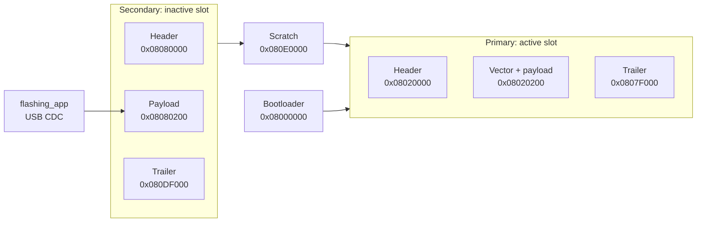
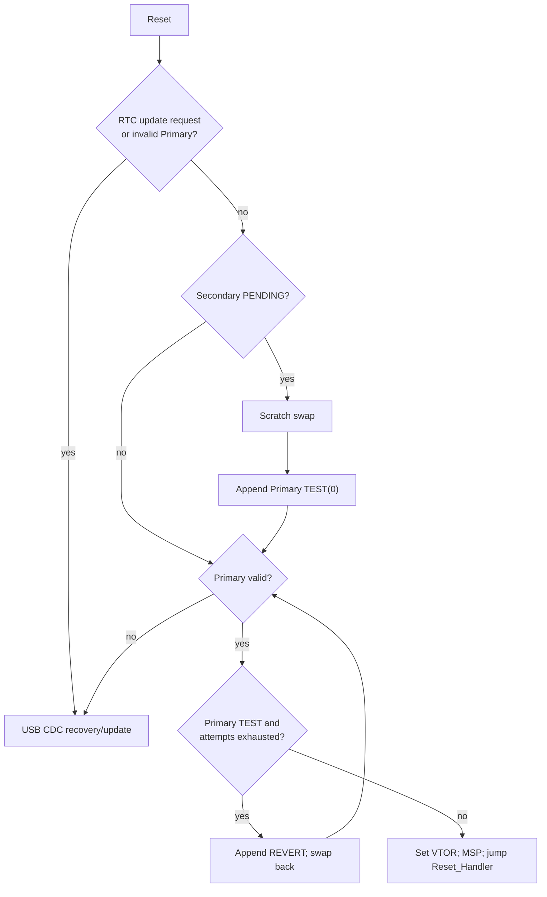

# STM32H723 bootloader design

## Purpose and current boundary

This is a compact reference for the implemented **A/B, dual-slot bootloader**:
an application is downloaded to an inactive Secondary slot, validated, swapped
through Scratch into Primary, booted as TEST, then made permanent only when the
application confirms it.  USB CDC is the update transport.

This design is functional through Sprint S9.  It is **not power-fail-safe while
a slot swap is in progress**.  Do not use it for a product that can lose power
during swap until the S10 journal/recovery work is complete.

## Flash ownership

| Flash range | Owner | Contents |
|---|---|---|
| `0x08000000-0x0801FFFF` | Bootloader | Immutable bootloader (sector 0, 128 KiB) |
| `0x08020000-0x0807FFFF` | Primary | Header, executable image, trailer journal (sectors 1-3) |
| `0x08080000-0x080DFFFF` | Secondary | Header, staged image, trailer journal (sectors 4-6) |
| `0x080E0000-0x080FFFFF` | Scratch | One-sector swap workspace (sector 7) |

The STM32H723 has a single internal Flash bank in this configuration.  Any
erase/program operation must execute the complete Flash routine and its
32-byte source buffer from DTCM/RAM with interrupts disabled.  This is
implemented in `bootloader/bootloader/Core/Src/boot_flash.c`.

## Image and trailer

- An image header is immutable metadata: magic, format, board ID, version,
  payload size/CRC, vector address, and header CRC.
- The payload begins at `0x08020200` in Primary or `0x08080200` in Secondary.
  The first two words are MSP and Reset_Handler.
- Each 4 KiB trailer holds 128 append-only 32-byte records.  A valid record
  has a valid magic, state, and record CRC; the valid record with greatest
  sequence is authoritative.
- State is never edited in place.  A new state is an additional record.

| State | Slot | Meaning |
|---|---|---|
| `DOWNLOADED` | Secondary | Transfer finalized and image validated. |
| `PENDING` | Secondary | Candidate is eligible for activation after reset. |
| `TEST(n)` | Primary | New image is running provisionally; `n` is hand-off count. |
| `CONFIRMED` | Primary | Current image is accepted. |
| `REVERT` | Primary | TEST attempt budget was exhausted; old Secondary image is restored. |

## Boot and update flow

1. A running application receives `UPDATE_FIRMWARE` over its CDC channel,
   writes a one-shot request to an RTC Backup Register, then resets.
2. Bootloader consumes that request (or enters recovery because Primary is
   invalid) and exposes its CDC protocol.
3. Host sends `BEGIN_UPDATE`, contiguous `WRITE_BLOCK`s, then `FINALIZE`.
   Payload is written only to Secondary; bootloader owns header/trailer writes.
4. `FINALIZE` verifies payload CRC/vector/metadata and appends `DOWNLOADED`,
   then `PENDING`.  `RESET` starts activation.
5. On a valid `PENDING`, each 128 KiB sector swaps `Primary -> Scratch`,
   `Secondary -> Primary`, `Scratch -> Secondary`.  Primary receives `TEST(0)`.
6. Application calls `app_bootloader_confirm()` after its own startup health
   checks.  This appends `CONFIRMED` and resets attempts to zero.

The TEST budget is three hand-offs.  If it is exhausted, bootloader appends
`REVERT`, swaps the prior confirmed image back from Secondary, and boots it.

## Application contract

- Link every managed app at `0x08020200`; application startup sets VTOR to
  that vector table.
- Include `app_bootloader` as a small, transport-independent API layer.
- Call `app_bootloader_confirm()` only after the app's real health criteria.
  The training apps call it after basic startup to demonstrate the path.
- The app update CDC command is deliberately isolated in
  `app/app_1/Core/Src/app_update_cdc.c`; another app may provide a different
  transport without changing bootloader logic.
- Application payload passed to the host is raw `.bin`, not `.elf` or `.hex`.
  `flashing_app` pads it to a 32-byte Flash word boundary, calculates the
  payload CRC, and creates the 128-byte transport header.

## Source map

| Responsibility | Implementation |
|---|---|
| Boot policy / jump | `bootloader/bootloader/Core/Src/boot_manager.c` |
| Image and trailer validation | `bootloader/bootloader/Core/Src/boot_image.c` |
| Secondary download | `bootloader/bootloader/Core/Src/boot_update.c` |
| Scratch swap | `bootloader/bootloader/Core/Src/boot_swap.c` |
| RAM Flash operations | `bootloader/bootloader/Core/Src/boot_flash.c` |
| USB protocol | `bootloader/bootloader/Core/Src/boot_protocol.c` |
| RTC one-shot request | `bootloader/bootloader/Core/Src/boot_request.c` |
| App API | `app_bootloader/Src/app_bootloader.c` |
| PC GUI / image packer | `flashing_tool/flashing_app.py` |
| Automated build/flash/capture | `tools/sprint0/Invoke-Sprint0.ps1` |

## Known limitations and next engineering work

- Swap progress is not journaled.  A power loss during a swap can leave slots
  ambiguous.  S10 must add mirrored phase/sector records and recovery tests.
- Journal compaction and trailer-full policy are not production hardened.
- USB protocol uses stop-and-wait but has no duplicate-response cache; host
  retries after a timeout must abort and restart the session.
- Security is not yet enabled: no signed images, anti-rollback counter, or
  protected key storage.  Secure boot is a separate future scope.

Evidence for each completed scope is retained in `input/test_input/`; the
test status and the next scope are in `BOOTLOADER_SPRINT_PLAN.md`.
