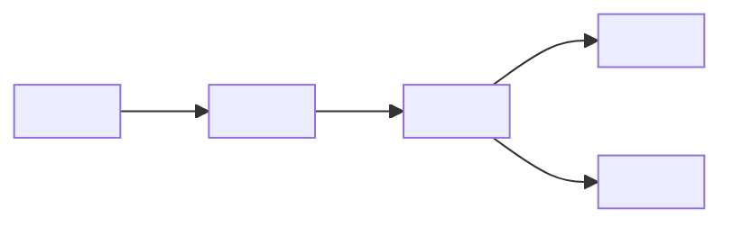

# Design: <project name>

## System purpose

`<one paragraph: input -> processing -> output, including the system boundary>`

## Architecture

## Component contracts

| Component | Owns | Input | Output | Failure behavior | Source owner |
|---|---|---|---|---|---|
| `<component>` | `<responsibility>` | `<contract>` | `<contract>` | `<safe behavior>` | `<path/API>` |

## State model

| State | Enter condition | Allowed actions | Exit condition | Persistent? |
|---|---|---|---|---|
| `<state>` | `<event>` | `<actions>` | `<event>` | `<yes/no>` |

## Invariants

- `<must always be true; write it as a testable statement>`
- `<ownership or address/range limit>`
- `<ordering/atomicity/recovery rule>`

## Interfaces and data

| Interface | Framing/schema | Validation | Timeout/retry | Compatibility |
|---|---|---|---|---|
| `<interface>` | `<format>` | `<checks>` | `<rule>` | `<version policy>` |

## Explicit limitations

| Unsupported condition | Consequence | Planned scope / mitigation |
|---|---|---|
| `<condition>` | `<impact>` | `<plan>` |

## Design-to-code-to-test map

| Design element | Source/API | Automated test | Hardware/system proof |
|---|---|---|---|
| `<rule>` | `<path:symbol>` | `<test name>` | `<report/log>` |
